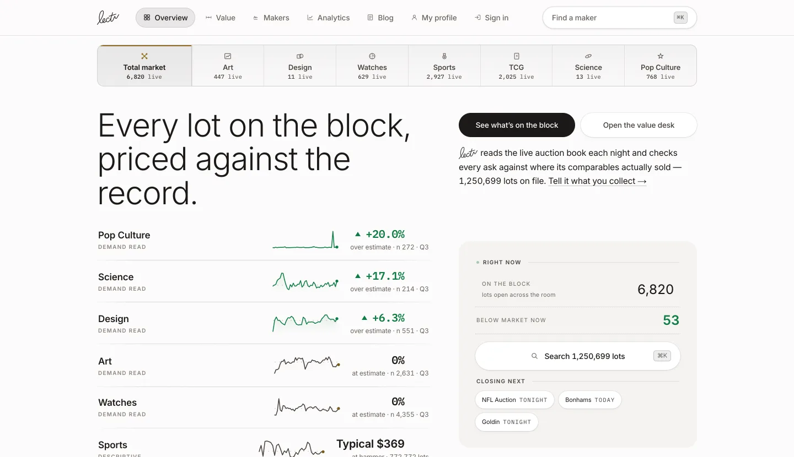
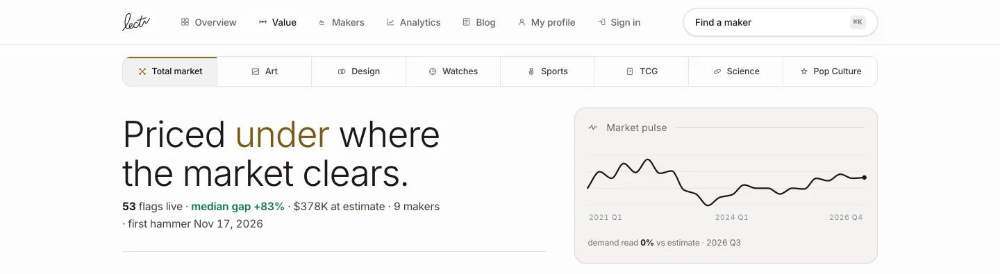
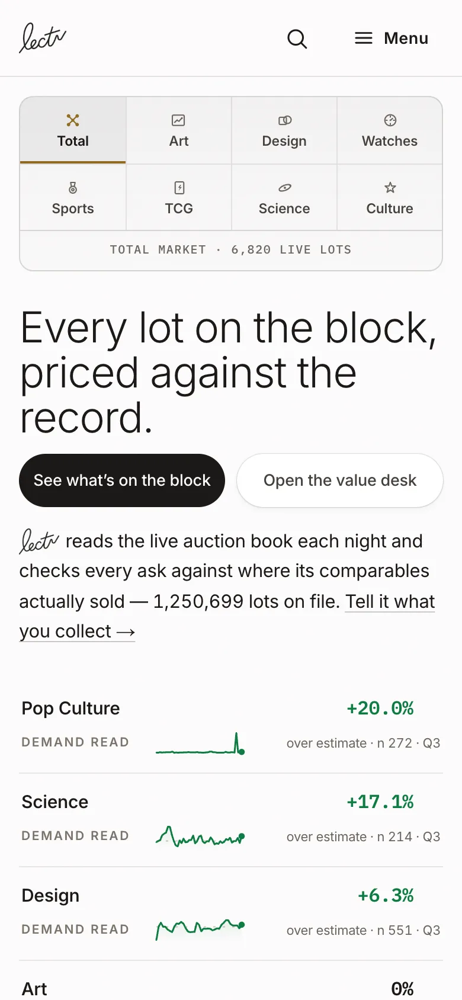
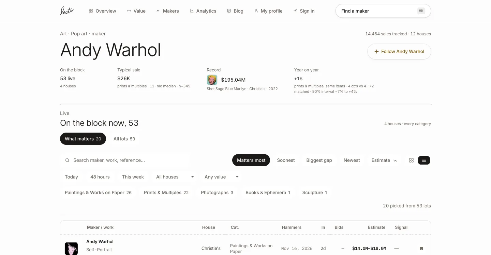
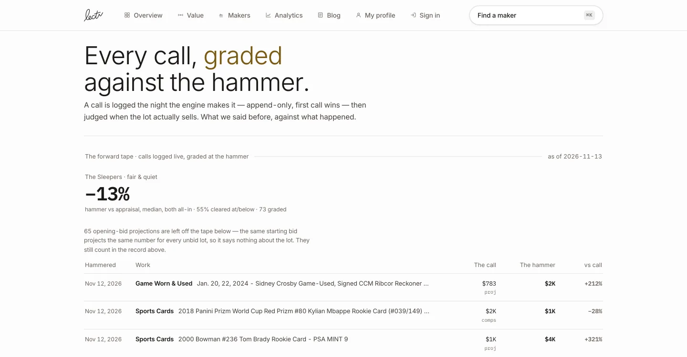

<div align="center">

<a href="https://lectr.bid"><picture><source media="(prefers-color-scheme: dark)" srcset="public/brand/lectr.png"></picture></a>

### Every lot on the block, priced against the record.

Auction-market intelligence for art, design, watches, sports, trading cards, science and pop culture.

**[lectr.bid](https://lectr.bid)** · [What is lectr](https://lectr.bid/about) · [The record](https://lectr.bid/receipts) · [Notes from the desk](https://lectr.bid/blog)

<br>

<a href="https://lectr.bid"></a>

</div>

---

lectr reads the live auction book every night. It prices each open lot against what its comparables actually sold for, flags the ones listed below market, and then grades every call against the hammer once the lot sells. It covers auctions only, never fixed-price listings, because an asking price isn't market data.

## By the numbers

Live from [lectr.bid](https://lectr.bid) on **November 13, 2026**:

| Metric | Detail |
|---|---|
| **1,250,699** lots on file | 1,227,110 sold results, 1989 to today |
| **21** auction houses | **16** crawled every night |
| **6,820** lots on the block | across 8 market views |
| **714,500** documents | in the static, sharded search index |
| **24.4%** median value error | 90-day forward tape, 2,276 graded lots. The house estimate midpoint scored **30.9%** on the same lots |
| **+44% vs +20%** | median result against estimate for flagged lots vs unflagged lots, over 17,975 point-in-time backtested calls |

> These figures are a snapshot. Live values are on [/receipts](https://lectr.bid/receipts) and in `public/data/ray/accuracy-ledger.json`, which is regenerated nightly.

## The product

<table>
<tr>
<td width="62%" valign="top">
<a href="https://lectr.bid/value"></a>
<br><sub><b>The value desk</b> (<code>/value</code>): live lots listed under where their comparables cleared, ranked by odds and gap.</sub>
</td>
<td width="38%" rowspan="2" valign="top" align="center">
<a href="https://lectr.bid"></a>
<br><sub><b>Built for phones too.</b> Every page works from 390 to 1440 px wide.</sub>
</td>
</tr>
<tr>
<td valign="top">
<a href="https://lectr.bid/andy-warhol"></a>
<br><sub><b>Maker dossiers</b>: typical sale, record, year-on-year move with its interval, and every live lot.</sub>
</td>
</tr>
</table>

<a href="https://lectr.bid/receipts"></a>
<sub><b>The record</b> (<code>/receipts</code>): each call is logged the night it's made, append-only with the first call winning, then judged when the lot sells.</sub>

### What's on the site

| Surface | Route | What it does |
|---|---|---|
| Overview | `/`, `/art`, `/design`, `/watches`, `/sports`, `/tcg`, `/science`, `/culture` | Demand read per market, lots on the block, what closes next |
| Value desk | `/value`, `/value/[market]` | Below-market flags, the gap and the sleepers, today's call |
| Makers | `/makers`, `/[artist]`, `/makers/[slug]` | The roster and per-maker dossiers |
| Lots | `/lot/[id]` | A lot priced against its comparables, with share previews that unfurl as the lot itself |
| Players and entities | `/p/[slug]`, `/e/[slug]` | Sports player and pop-culture entity dossiers |
| References and sub-markets | `/ref/[maker]/[key]`, `/sub/[a]/[b]` | Watch references, furniture models, drill-downs |
| Analytics | `/analytics` | Rankings, house calibration, seasonality |
| The record | `/receipts` | The forward tape of graded calls |
| My profile (the Desk) | `/profile` | Follows, saved lots, alerts, "my max", picks. Optional opt-in Daily Desk email |
| Notes | `/blog` | Quarterly market notes, corrections, methodology |

## Coverage

Markets are split by maker or entity, not by house, and every lot is routed on its own.

| Market | Houses |
|---|---|
| **Art** | Christie's, Sotheby's, Phillips, Bonhams |
| **Design** | Wright, Rago, Phillips, LAMA |
| **Watches** | Phillips, Christie's, Sotheby's, Bonhams |
| **Sports** | Goldin, REA, Huggins & Scott, Lelands, Memory Lane, Love of the Game, SCP, Hake's, NFL Auction, MLB Auctions |
| **TCG** | Goldin and the card houses: singles, vintage, sealed product, lots and sets |
| **Science** | Christie's, Sotheby's, RR Auction, Goldin. Covers tech, space, fossils and instruments, never video games |
| **Pop Culture** | RR Auction, Julien's, Propstore, Goldin, Christie's, Sotheby's |

**Deepest archives:** Goldin (435,813 lots), RR Auction (242,723), REA (182,300), Huggins & Scott (105,662), Christie's (78,199, back to 1991) and Sotheby's (65,932).

## How it works

```
 cron Worker ─► nightly.yml (GitHub Actions)
                 ├─ crawl      16-house matrix, one segment per house (last-good on failure)
                 ├─ assemble   reunite → hygiene passes → validate → sanity + engine gates
                 │             → R2  versions/<utc>-<sha>/  (write-once, behind latest/pointer.txt)
                 ├─ deploy     next build (static export) → Cloudflare Pages → lectr.bid
                 ├─ sync       Supabase mirror + alerts (non-blocking)
                 ├─ backtest   incremental Mon–Sat · full point-in-time replay Sunday
                 └─ health     per-house issues, publish verdict, social desk
```

- **The site is a static export with no app server.** Next.js `output: 'export'` deploys to Cloudflare Pages. The client loads JSON in tiers: an eager first screen, then the full-history shards, with the sold archive lazy-loaded only when a page needs it.
- **Pages Functions do a little work at the edge.** They serve per-lot and per-dossier share previews for bots, a small `/api` over the R2 lot store, and the email unsubscribe link.
- **R2 is the source of truth.** The full v2 corpus is gzipped and written once per run. Readers poll a single pointer file, which is written last, so they never see a half-written version. The newest 14 versions are kept.
- **Supabase is optional.** It powers sign-in and the Desk (saved lots, alerts, follows). Without its env vars, saves fall back to `localStorage`.
- **Houses fail independently.** A house that crashes or shrinks serves its last-good segment, opens its own issue, and closes that issue when it recovers. If a house has no good crawl for 48 hours, its live lots are hidden rather than served stale. See [`docs/RUNBOOK.md`](docs/RUNBOOK.md).

Mechanics by job: [`docs/data-pipeline.md`](docs/data-pipeline.md).

## The engine

**One comparability engine** ([`app/lib/comps.ts`](app/lib/comps.ts)) feeds the lot signal, the comparables view and the crawl-time precompute. It uses a 26-form taxonomy with hard gates on form, size and model, so a Daytona never comps a Datejust and an LC2 never comps a Chandigarh chair. It adds a same-edition fast path, an IQR dispersion guard and four confidence tiers.

**Multiple lanes.** Flags, the Gap and the Sleepers are separate reads with separate records, defined once in [`app/lib/lanes.ts`](app/lib/lanes.ts). See [`docs/ENGINE_LANES.md`](docs/ENGINE_LANES.md) and [`docs/ENGINE_SPEC_V2.md`](docs/ENGINE_SPEC_V2.md).

**Price movement, measured two ways:**
- **Hedonic index** ([`scripts/hedonic-index.ts`](scripts/hedonic-index.ts)): a robust per-maker log-price regression that holds mix constant (reference, form, size, decade, house). A horizon publishes a return only when its 95% confidence interval resolves the sign.
- **Repeat-sales index** ([`scripts/repeat-sales.ts`](scripts/repeat-sales.ts)): Bailey-Muth-Nourse, the Case-Shiller method. It runs on the card market, which carries no estimates, and links resales of the same card by player, year, set, number, grade and serial.

Where neither index can defend a number, the page falls back to measured **demand** (typical sale against estimate). Where even that isn't possible, it shows a descriptive read: typical price, record and volume.

**Graded in public.** Every call is backtested point-in-time and logged forward on the tape. Each month a report lands in [`docs/accuracy/`](docs/accuracy/).

### The data model

The canonical `AuctionLot` lives in [`app/types.ts`](app/types.ts) and rests on three rules:

1. **The native currency is the fact.** USD is derived with a dated, checked-in FX table, so no price-against-estimate comparison ever crosses currencies.
2. **Identity is persisted.** Model or reference keys, parsed dimensions, editions, serials and card fingerprints are stored rather than re-derived, so "has this exact item sold before?" is a lookup.
3. **Every row is validated before it ships.** The write-time gate in [`app/lib/validate.ts`](app/lib/validate.ts) aborts the publish rather than ship a bad row.

### Rules

- **Auctions only.** No buy-it-now, fixed-price or retail listings.
- **No unsupported returns.** No appreciation figure is published without a confidence interval behind it.
- **Honest numbers.** Red means down, green means up. Realized and hammer prices are facts, and a mix-noise average is never shown as demand.
- **Buyer's premium is stated.** Prices are what the buyer pays, and every sold row carries a `priceBasis`.

## Stack

Next.js 16 (static export) · React 19 · TypeScript · Tailwind · Recharts · Cloudflare Pages, Pages Functions, R2 and Workers · Supabase (auth and Postgres) · GitHub Actions · DuckDB, cheerio and Playwright for the pipeline · Resend for email · Node 22.

## Development

```bash
nvm use                 # Node 22
npm install
npm run data:pull       # latest served payload from R2 (CLOUDFLARE_API_TOKEN or `npx wrangler login`)
npm run dev             # http://localhost:3000
```

| Command | Does |
|---|---|
| `npm run build` | Share cards, redirects, first screen, `next build`, then the CSP and first-paint post-build steps → `out/` |
| `npm run typecheck` | `tsc --noEmit` |
| `npm run lint` | ESLint (flat config) |
| `npm test` | Unit tests (`scripts/__tests__`, `tests/`) |
| `npm run crawl` | Crawl → normalize → validate → precompute. Incremental Mon–Sat, full sweep Sunday |
| `INCREMENTAL_CRAWL=0 npm run crawl` | Force a full sweep |
| `RAY_ONLY=<slug> npm run crawl` | Crawl only the named slugs |
| `npx serve out` | Preview the static export |

### Configuration

Copy only what you need. The site builds and runs with none of these set.

| Variable | Used for |
|---|---|
| `NEXT_PUBLIC_SUPABASE_URL`, `NEXT_PUBLIC_SUPABASE_ANON_KEY` | Sign-in and the Desk (see [`SUPABASE_SETUP.md`](SUPABASE_SETUP.md); run `supabase/migrations/` in order) |
| `NEXT_PUBLIC_VAPID_PUBLIC_KEY` | Web push alerts |

The CI secrets are `CLOUDFLARE_*` and `CF_*` tokens (Pages, R2 read/write, Workers), `SUPABASE_URL`/`SUPABASE_SERVICE_KEY`, `RESEND_API_KEY`, `VAPID_PRIVATE_KEY`, the social-desk tokens, and `LECTR_DISPATCH_PAT` for the cron Worker.

## Deployment

Deploys are fully automated, and there's no server to provision.

- **Nightly data**: [`nightly.yml`](.github/workflows/nightly.yml), dispatched on the minute by the [`cron-trigger`](workers/cron-trigger) Worker, with GitHub cron as a guarded fallback.
- **Code**: [`deploy.yml`](.github/workflows/deploy.yml) on every push to `main` pulls the served payload, builds, and runs `wrangler pages deploy`.
- **Intraday**: `close-board.yml` refreshes what's closing every four hours, and `daily-desk.yml` sends the opt-in morning email.
- **Upkeep**: a monthly accuracy report, a quarterly restore drill, daily UI screenshots, plus manual backfill and heal workflows for each house.

When a run goes red, start with [`docs/RUNBOOK.md`](docs/RUNBOOK.md).

## Repository map

```
app/                 Next.js routes, components, hooks
  lib/               comps, demand, normalize, validate: the engine's core
  types.ts           the canonical AuctionLot (v2)
functions/           Cloudflare Pages Functions (share previews, /api, unsubscribe)
workers/             the cron-trigger Worker
scripts/             crawlers, assemble, market build, indices, backtest, OG cards
  lib/houses/        per-house fetch + parse modules
  ci/                gates, replay checks, test runner
supabase/migrations/ schema for accounts and the Desk
public/data/ray/     served JSON shards (pulled from R2, not committed)
docs/                runbook, pipeline, engine specs, UI law, accuracy reports
```

Internal names such as `ray-*`, `useRayData` and `public/data/ray/` predate the rename to lectr. They're kept for stability.

### Docs

[RUNBOOK](docs/RUNBOOK.md) · [Data pipeline](docs/data-pipeline.md) · [Engine spec v2](docs/ENGINE_SPEC_V2.md) · [Engine lanes](docs/ENGINE_LANES.md) · [The Desk](docs/DESK.md) · [Picks](docs/PICKS.md) · [Retention](docs/RETENTION.md) · [Social](docs/SOCIAL.md) · [UI north star](docs/NORTHSTAR_UI.md) · [Accuracy reports](docs/accuracy/)

## License

The source is public for transparency, but it is **not open source**. All rights are reserved. See [LICENSE](LICENSE).
